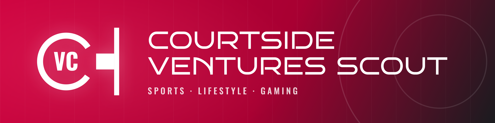
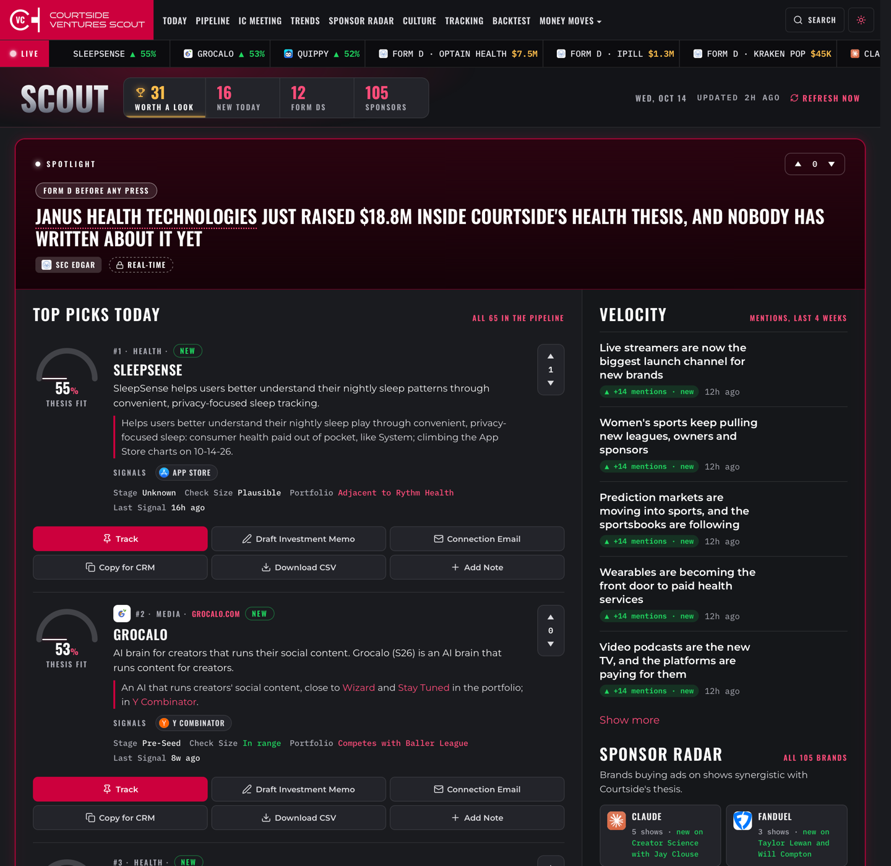

# 🏀🔭 Courtside Ventures Scout



> A prototype of an AI scout optimized for sourcing and tracking Sports, Gaming, Lifestyle, & Entertainment startups synergistic with Courtside Ventures.

[](https://github.com/adriangrantdotorg/Courtside-Ventures-Scout/actions/workflows/check.yml) [](package.json) [](https://nextjs.org/) [](https://neon.tech/) [](https://vercel.com/)

**VIEW LIVE DEMO →** [courtside-ventures-scout.vercel.app](https://courtside-ventures-scout.vercel.app)

---

## ✨ Page Features



- 🎯 **Today** — Your morning coffee read: the one 'Must See' deal + Top 5 cos that should be your radar + startups that are heating up
- 🗂️ **Pipeline** — Thesis-friendly startups, ranked by fit, with a lightweight CRM to move deals from 'New' to 'Reached Out'
- 🗓️ **IC Meeting** — Your Monday Partner Meeting Starter Packer, i.e. the week's top startups and trends 
- 📈 **Trends** — The ideas picking up steam across news, creators, filings and the App Store
- 📻 **Sponsor Radar** — Brands buying ads on the shows the Courtside world listens to (i.e. often the first sign a company just raised or is scaling)
- 🎧 **Culture** — The brands and startups 100+ creators and shows are talking about, so you catch taste shifts before the press does
- 🔔 **Tracking** — The companies, trends and people you follow, plus custom alerts, checked every morning and ready for Slack
- ⏪ **Backtest** — How many days before the investment announcement would Scout have the deal
- 💵 **Throw Some D's on It** — Fresh SEC Form D and Form C filings inside the thesis, flagged when no press has covered them yet
- 🏘️ **Neighborhood** — What Courtside's co-investors just backed, i.e. hear about the next shared deal early
- 🤝 **Synergistic Funders** — Funds with a Courtside-style thesis that haven't co-invested yet, and who they're backing now

---

## 📋 Prerequisites

- **Node.js** v20+ — [Install here](https://nodejs.org/)
- **Vercel account** (free Hobby plan) — [Sign up](https://vercel.com/signup)
- **Neon account** (free plan) — [Sign up](https://neon.com/)

---

## 🚀 Installation

### Quick Start

One command from a fresh clone to a live, filled, verified Scout on your own free Vercel and Neon accounts:

```bash
npm run launch
```

Five steps, each shown on the progress page that opens and in the terminal:

| **Step** | **What happens** |
| -------- | ---------------- |
| 1. Setup | Signs you in, links the Vercel project, creates the Neon database, sets the environment |
| 2. Database | Creates the tables and loads the launch seed |
| 3. Build and tests | One production build, the unit tests, then the browser suite against that build |
| 4. Deploy | Uploads the build that was just tested |
| 5. Open | Checks the live site, then opens it |

The only moment it may need you: approving the Vercel login page once.

### Keeping it current

```bash
npm run update
```

Pulls the newest version and redeploys it.

---

## 🗓️ What Runs Each Day


| **Job** | **When** |
| ------- | -------- |
| Co-investor watch (the Neighborhood) | 2 AM ET |
| Synergistic funder watch | 3 AM ET |
| Creators and shows (YouTube and podcast feeds), people | 4 AM ET |
| Startup signals: SEC Form D and Form C, Hacker News, Y Combinator, Product Hunt, App Store charts, funding and industry news, Google Trends, Courtside's posts | 5 AM ET |
| Scoring, "why it fits", portfolio check | 6 AM ET |
| Alerts | 7 AM ET |
| Culture (mentions and stance) | 8 AM ET |
| Trends | 9 AM ET |
| Sponsor Radar | 10 AM ET |
| The Monday brief | Mondays, 11 AM ET |
| Weekly upkeep: portfolio, link checks, the 90-day podcast rule, new Courtside posts into the backtest | Sundays, 2 AM ET |

---

## 💡 Usage Examples

Customize via **Settings** on the site and or ask your agent — Scout has you covered either way!

### Add a creator or show

```
"Add a creator or show to Scout"
```

Or paste a YouTube channel URL, podcast name or RSS URL in **Settings › Creators and Shows**.

### Tune what Scout reads

```
"Turn off a source"
```

### Change how picks are ranked

```
"Change the scoring weights"
```

The agent will:

- Find the setting or rule behind the request
- Make the change and run the checks
- Redeploy so the live site picks it up

---

## 🧩 Optional Extras

| **Extra** | **What it adds** | **How to turn it on** |
| --------- | ---------------- | --------------------- |
| 🤖 AI drafting | Memo drafts, written summaries, plain-English alerts | Say "turn on AI" to your agent. Runs on Vercel's free AI credit, which asks for a card on file; nothing is charged on the free credit |
| 💬 Slack | Alert hits and the Monday brief in a channel | Say "set up Slack". About 4 clicks, once |

---

## ⚠️ Prototype Limits 

- **Once a day** — Each job runs once a day (Vercel Hobby)
- **YouTube rate limits** — The keyless channel feeds sometimes rate-limit; Scout backs off and the podcast feeds cover those creators meanwhile
- **Partial ad picture** — Many shows insert ads dynamically and leave them out of show notes, so our Sponsor Radar only sees part of the picture
- **Links only** — X, Instagram, TikTok, Twitch, Kick, LinkedIn and PitchBook are links only

---


<div align="center">
  <sub>Created by [Adrian Grant](https://www.linkedin.com/in/adriangrant3/)</sub>
</div>
